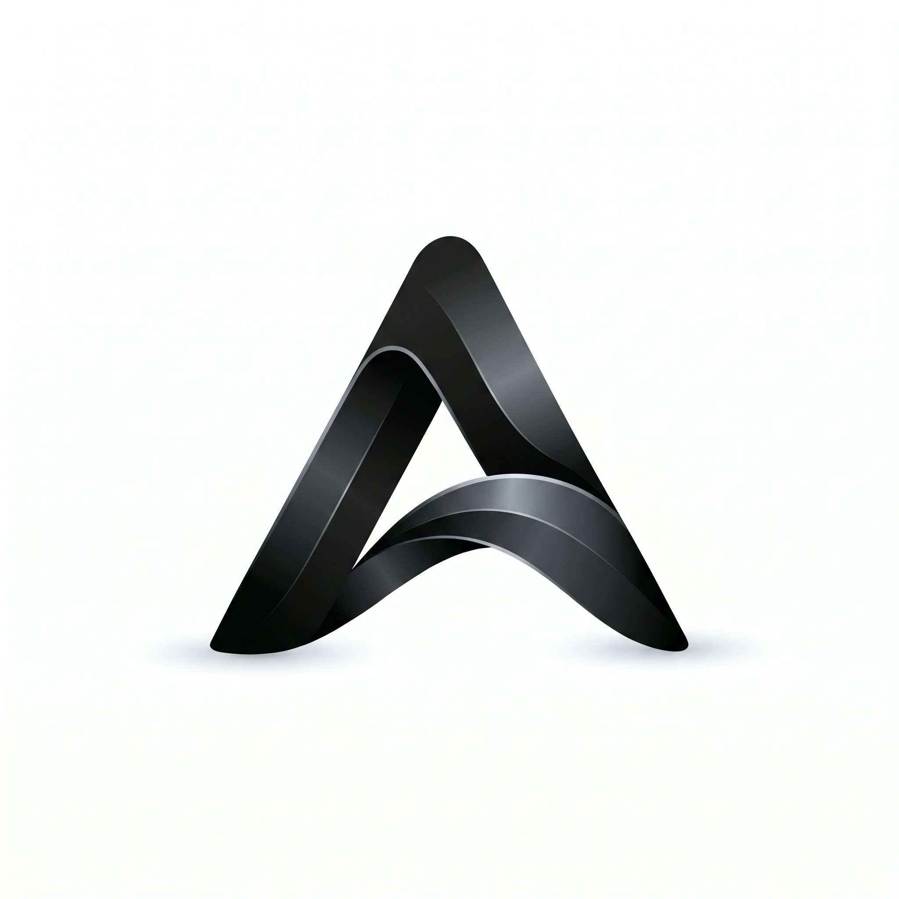
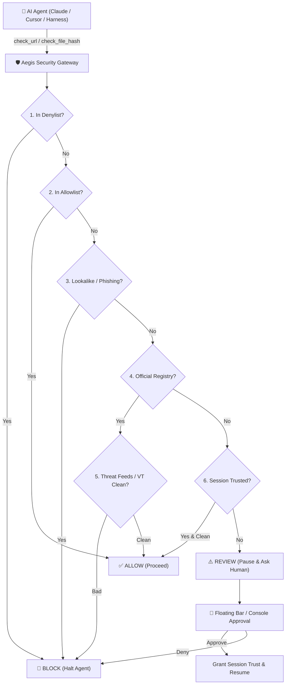

<div align="center">



# Aegis

**Truth before trust — Local Network Security Gateway & Sandbox Defense for AI Agents**

[](https://opensource.org/licenses/MIT)
[](package.json)
[](vitest.config.ts)
[](#cross-platform-architecture)
[](#mcp-tools-reference)

[🇺🇸 English](./README.md) | [🇨🇳 简体中文](./README_CN.md)

</div>

---

## 🛡️ What is Aegis?

**Aegis** is a local, high-performance cybersecurity gateway designed specifically for **Autonomous AI Agents** (Claude Code, Cursor, AutoGPT, LangChain, custom Agent Harnesses).

As AI agents gain access to web search, curl tools, and terminal commands, they face serious supply-chain and network threats:
* **Typosquatting & Homograph Attacks**: Agents frequently click lookalike search results (`g1thub.com`, `pyp1.org`, punycode domains).
* **Malicious Payloads & Poisoned Dependencies**: Agents downloading unvetted scripts or installer packages.
* **Prompt Injection & SSRF**: Malicious web pages tricking the agent into accessing sensitive internal intranet IP ranges or cloud metadata endpoints.
* **Zero-Sandbox Execution**: Unsandboxed scripts compromising local secrets (`~/.ssh`, `~/.aws`, browser credentials, keychains).

Aegis solves this by standing as a **mandatory preflight security gate** between the AI agent and the outside world. Every network destination, downloaded file, or execution command must be verified by Aegis before the agent is permitted to proceed.

---

## ✨ Key Features

### 1. Tri-State Decision Gate (`allow` / `review` / `block`)
* **`ALLOW`**: Verified official domains, known clean reputations, or session-trusted destinations. The agent continues uninterrupted.
* **`REVIEW`**: Unknown domains or suspicious signals. The agent **stops execution** and waits for human-in-the-loop confirmation via the floating desktop bar or console.
* **`BLOCK`**: Malicious reputation, typosquats, listed threat feeds, or explicit denylists. The agent is strictly prevented from connecting.

### 2. Multi-Source Domain Authority Engine
* **Official Brand Registry**: Built-in authoritative registry covering 200+ major developer ecosystems (GitHub, npm, PyPI, HuggingFace, Cloudflare, AWS, GCP, etc.).
* **Custom Brand Management**: Operators can register corporate internal domains (`intranet.corp.local`) as first-class authority matches.
* **Lookalike & Homoglyph Detection**: Levenshtein distance calculations against official domains detect brand impersonation in milliseconds.
* **RDAP Live Verification**: Real-time domain registrant and organization verification.

### 3. Threat Intelligence & VirusTotal Integration
* **Multi-Feed Intel**: Integrated with URLhaus, OpenPhish, and local threat caches.
* **VirusTotal API v3 Engine**: Automated reputation checks for domains, URLs, and file hashes with automatic rate-limit throttling and offline degraded fallback.
* **Direct File Upload Scan**: One-click or automated VirusTotal deep file upload scanning for downloaded artifacts (up to 32MB).

### 4. Cross-Platform Security Sandbox
* **OS-Level Kernel Isolation**:
  * **macOS**: `sandbox-exec` (Seatbelt) profile with `deny(default)`, blocking network calls and restricting writes strictly to ephemeral temporary roots.
  * **Linux**: Bubblewrap (`bwrap`) unprivileged user namespaces.
  * **Windows**: Restricted non-elevated safety policies with execution refusals on unisolated targets.
* **Zero-Leak Policy**: Strictly denies read access to sensitive paths (`~/.ssh`, `~/.aws`, `~/.config`, macOS Keychain, Windows credentials).
* **Safe ZIP Extraction**: Built-in traversal-safe (`zip-slip` immune) decompression engine that inspects archive members without execution.

### 5. Static Package & Binary Probe (`analyze_installer`)
* Non-executing static inspection of binaries, packages, and installer scripts:
  * **File Magic Sniffing**: PE-EXE, Mach-O, ELF, ZIP, MSI, PKG, JAR, DEB, AppImage.
  * **Shannon Entropy Meter**: Detects packed, obfuscated, or encrypted payloads.
  * **Heuristic String Extraction**: Flags dangerous shell commands (`Invoke-Expression`, `curl | bash`, `LaunchDaemon`, `wallet.dat`, ransomware markers).
  * **AI Security Brief**: Synthesizes findings into an executive risk summary for LLM reasoning.

### 6. Modern Cyber Defense Console & Floating Bar
* **Always-On-Top Desktop Floating Bar**: Non-intrusive floating pill for instant human approval when an agent hits a `review` decision.
* **Cyber Aesthetic Dark / Light Mode**: Sleek glassmorphism theme, real-time diagnostic drawers, and multi-factor history search & filtering.
* **Client-Side WebCrypto Hashing**: Instant drag-and-drop file hash calculation in the browser without uploading heavy payloads.

---

## 🏛️ Architecture & Decision Pipeline



---

## 🚀 Quick Start

### Prerequisites
* **Node.js**: v18.16.0 or higher
* **OS**: macOS (Apple Silicon / Intel), Linux (x64), or Windows 10/11 (x64)

### 1. Installation

```bash
git clone https://github.com/your-org/aegis.git
cd aegis
npm install
npm test
```

### 2. Running in Development Mode

```bash
npm run dev
```
This concurrently starts:
* **Core API Server**: `http://127.0.0.1:7832/api/v1`
* **Vite Console UI**: `http://127.0.0.1:5173`
* **Electron Desktop Shell & Floating Bar**

### 3. Packaging Desktop Application

```bash
# Package for macOS (DMG & .app)
npm run pack:app

# Output binaries:
# release/mac-arm64/Aegis.app
# release/Aegis-0.1.0-arm64.dmg
```

### 4. Headless Mode (HTTP + MCP only, No Desktop GUI)

```bash
# Start HTTP Gateway daemon on 127.0.0.1:7832
npm run dev:server

# Start MCP stdio server directly
npx tsx server/index.ts --mcp
```

---

## 🔌 Integration with AI Agents

### Option A: Model Context Protocol (MCP)

Aegis is a native Model Context Protocol (MCP) server. You can connect it directly to **Claude Desktop**, **Cursor**, or any MCP-compatible agent harness.

#### Claude Desktop Configuration
Add Aegis to `~/Library/Application Support/Claude/claude_desktop_config.json` (macOS) or `%APPDATA%\Claude\claude_desktop_config.json` (Windows):

```json
{
  "mcpServers": {
    "aegis": {
      "command": "node",
      "args": ["/ABSOLUTE/PATH/TO/aegis/dist-server/index.js", "--mcp"],
      "env": {
        "AEGIS_DATA_DIR": "/ABSOLUTE/PATH/TO/aegis/.aegis"
      }
    }
  }
}
```

> 💡 **Tip**: You can click **"Copy MCP JSON"** or **"Download ZIP"** directly in the Aegis Console under the **Integrate** tab!

#### Cursor Configuration
In Cursor Settings ➜ **Features** ➜ **MCP Servers** ➜ **Add New MCP Server**:
* **Name**: `aegis`
* **Type**: `command`
* **Command**: `node /ABSOLUTE/PATH/TO/aegis/dist-server/index.js --mcp`

---

### Option B: Direct HTTP REST API

For custom agent harnesses (Python, Go, LangChain, AutoGPT):

```bash
# 1. Preflight URL check before navigating
curl -X POST http://127.0.0.1:7832/api/v1/check \
  -H "Content-Type: application/json" \
  -d '{"url": "https://github.com/modelcontextprotocol/servers", "context": "user requested repo clone"}'

# Response:
# {
#   "decision": "allow",
#   "score": 95,
#   "hostname": "github.com",
#   "authority": { "official": true, "brand": "GitHub" },
#   "virusTotal": { "status": "clean", "malicious": 0 }
# }
```

---

## 📋 Agent Guard Protocol (Harness Rules)

To ensure maximum safety, your agent harness system prompt or agent skill should enforce the **Agent Guard Protocol**:

```markdown
### AGENT GUARD PROTOCOL
1. PREFLIGHT: Call `check_url` before accessing, navigating, or downloading from ANY URL.
2. ALLOW: If `decision === "allow"`, you may proceed with the network request.
3. BLOCK: If `decision === "block"`, HALT immediately. Do NOT attempt workarounds or alternative mirrors.
4. REVIEW: If `decision === "review"`, DO NOT visit the URL. Notify the user and ask for approval, or wait for approval on the Aegis floating bar. Once confirmed, you may call `trust_domain`.
5. SEARCH RESULTS: For web search listings, pass URLs through `scan_search_results` (≤20 items). Follow ONLY items that return `allow`.
6. DOWNLOADS: After downloading any file, check its hash with `check_file_hash`. If flagged, quarantine the file.
7. BINARIES & INSTALLERS: Use `analyze_installer` to inspect local packages without executing them. Run verification commands exclusively inside `run_in_sandbox`.
```

---

## 🧰 MCP Tools Reference

| Tool Name | Parameters | Description |
| :--- | :--- | :--- |
| `agent_guard_policy` | *none* | Returns harness rules, session-trusted hosts, and custom brand configurations. |
| `check_url` | `url`, `context?` | Core preflight gate check for a target URL before visiting. |
| `scan_search_results` | `urls` (string[]) | Batch checks up to 20 search result URLs; filters out unsafe links. |
| `check_urls_batch` | `urls` (string[]) | Batch gate evaluation returning aggregate score and worst-case decision. |
| `check_file_hash` | `hash`, `fileName?` | Queries VirusTotal and local threat database for a downloaded file hash. |
| `upload_scan_file` | `path?`, `base64?` | Uploads downloaded files (≤32MB) to VirusTotal for immediate dynamic/static scan. |
| `analyze_installer` | `path`, `context?` | Non-executing static analysis of PE/ELF/Mach-O/ZIP packages (entropy, strings, URLs, AI brief). |
| `run_in_sandbox` | `argv`, `target?`, `timeoutMs?` | Runs commands in an OS-isolated sandbox (Seatbelt / bwrap). Network access is blocked. |
| `extract_in_sandbox`| `path`, `timeoutMs?` | Traversal-safe, path-sanitized ZIP unpacking inside the sandbox without execution. |
| `trust_domain` | `hostname`, `reason?` | Grants temporary session-trust to an approved hostname after human confirmation. |
| `session_trust` | *none* | Lists all hostnames currently trusted in the active session. |
| `untrust_domain` | `hostname` | Revokes session-trust for a previously trusted host. |
| `get_pending_reviews`| *none* | Retrieves pending URLs currently waiting for human approval. |
| `resolve_review` | `id`, `decision`, `alwaysAllow?` | Resolves a pending review after obtaining explicit human confirmation. |
| `verify_domain` | `domain` | Fast authority-only domain verification without external VT calls. |
| `get_gate_status` | *none* | Returns engine health, VT live/degraded mode, policy mode, and stats. |

---

## 📡 HTTP REST API Endpoints

All endpoints are mounted under `/api/v1`:

| Method | Endpoint | Description | Auth Required |
| :--- | :--- | :--- | :--- |
| `GET` | `/health` | Engine status, policy mode, VT mode, and counters | No |
| `GET` | `/session-token` | Generates CSRF session token for browser origins | Origin check |
| `POST` | `/check` | Evaluates URL gate check | `X-Aegis-Token` |
| `POST` | `/check-file` | Evaluates file hash gate check | `X-Aegis-Token` |
| `POST` | `/check-batch` | Evaluates batch URLs (≤20) | `X-Aegis-Token` |
| `POST` | `/upload-scan` | Base64 file upload for VirusTotal scan | `X-Aegis-Token` |
| `POST` | `/analyze-installer` | Static binary analysis on local path | `X-Aegis-Token` |
| `POST` | `/sandbox/run` | Executes command in kernel sandbox | `X-Aegis-Token` |
| `POST` | `/sandbox/extract` | Traversal-safe archive extraction in sandbox | `X-Aegis-Token` |
| `GET` | `/reviews` | Lists pending review items | No |
| `POST` | `/reviews/:id/resolve` | Approves or blocks a pending review | `X-Aegis-Token` |
| `GET` | `/session-trust` | Lists active session-trusted domains | No |
| `POST` | `/session-trust` | Adds host to session trust | `X-Aegis-Token` |
| `DELETE`| `/session-trust/:host` | Revokes host from session trust | `X-Aegis-Token` |
| `GET` | `/mcp-deploy/bundle` | Generates JSON & install configs for Claude/Cursor | No |
| `GET` | `/history` | Returns recent audit decision log | No |
| `GET` | `/history/export` | Exports history as `csv` or `json` | No |
| `DELETE`| `/history` | Clears all history records | `X-Aegis-Token` |

---

## ⚙️ Configuration

Aegis configuration is stored in `.aegis/config.json` in development, or in `~/Library/Application Support/Aegis/config.json` in packaged macOS apps:

```json
{
  "vtApiKey": "your-virustotal-api-key-here",
  "policyMode": "tri",
  "language": "en",
  "enableRdap": true,
  "allowlist": ["corp.internal.net"],
  "denylist": ["malicious-domain.com"],
  "soundEnabled": true,
  "maxUploadBytes": 33554432,
  "customBrands": [
    {
      "host": "intranet.company.com",
      "brand": "Company Internal",
      "subject": "Corporate Portal"
    }
  ]
}
```

* **`vtApiKey`**: Optional VirusTotal API key. If omitted, Aegis runs smoothly in degraded mode (authority + RDAP + threat intelligence).
* **`policyMode`**:
  * `tri`: Recommended. Tri-state (Allow / Review / Block).
  * `strict`: Zero-trust. Only explicit official and allowlisted domains pass.
  * `observe`: Audit mode. Logs warnings but rarely blocks.
* **`maxUploadBytes`**: Maximum file size permitted for automated VirusTotal upload scans (default: 32MB).

---

## 🔒 Security Architecture & Guarantees

* **Local-First & Zero Cloud Leak**: Aegis runs entirely on your local machine. URL checks and policies are evaluated locally.
* **Strict CSRF & Token Defense**: Mutating HTTP endpoints (`POST`, `PUT`, `DELETE`) require a valid `X-Aegis-Token` header to protect against unauthorized web-page cross-origin requests.
* **Kernel Sandbox Isolation**: Command execution in `run_in_sandbox` utilizes OS kernel facilities (`sandbox-exec` on macOS, `bwrap` on Linux). Network sockets are blocked at the system call level.
* **Refusal on Unisolated Platforms**: If kernel isolation cannot be guaranteed (e.g. on unconfigured hosts), Aegis **explicitly refuses to execute** payloads rather than running a "fake sandbox", steering the agent toward non-executing static analysis.

---

## 📄 License

MIT License © 2026 Aegis Project.
See [LICENSE](LICENSE) for details.
