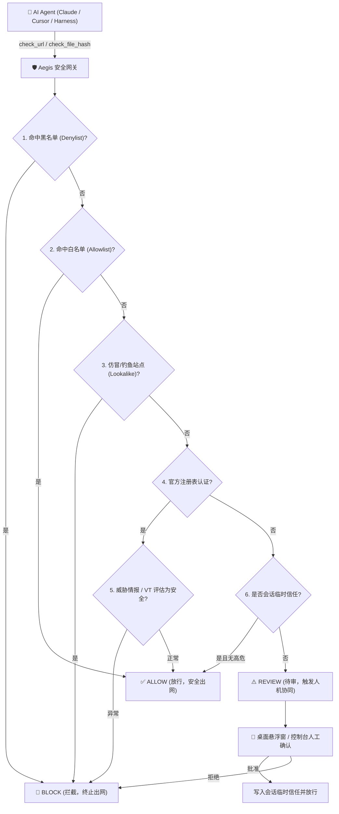

<div align="center">


# Aegis (神盾)

**出网前核查，安全前置 — 面向自主 AI Agent 的本地网络安全网关与沙箱防御系统**

[](https://opensource.org/licenses/MIT)
[](package.json)
[](vitest.config.ts)
[](#跨平台安全沙箱架构)
[](#mcp-工具参考速查)

[🇺🇸 English](./README.md) | [🇨🇳 简体中文](./README_CN.md)

</div>

---

## 🛡️ 什么是 Aegis？

**Aegis** 是专为 **自主 AI Agent**（Claude Code、Cursor、AutoGPT、LangChain、自研 Agent Harness）量身打造的本地高性能网络与文件安全网关。

随着 AI Agent 获得网络搜索、curl 下载与终端命令执行权限，它们正面临严重的新型网络安全威胁：
* **仿冒域名与同形文字攻击 (Typosquatting & Homograph)**：Agent 在浏览网络搜索结果时，极易误入钓鱼仿真站点（如 `g1thub.com`、`pyp1.org`、Punycode 障眼法域名）。
* **恶意依赖与投毒安装包**：Agent 自主下载并安装未经核验的脚本、包文件或可执行程序。
* **Prompt 注入与内网穿透 (SSRF)**：恶意网页通过隐蔽 Prompt 诱导 Agent 扫描或访问内网敏感资产、云元数据服务（169.254.169.254）。
* **无沙箱执行风险**：在裸机上直接运行 Agent 下载的脚本，导致凭证泄露（`~/.ssh`、`~/.aws`、浏览器 Cookie、系统钥匙串）。

Aegis 在 **Agent 与外部互联网之间建立强制前置门禁**。在 AI 访问任何 URL、下载任何文件或执行任何分析命令前，必须先经 Aegis 审核并作出 `放行 (Allow)` / `待审 (Review)` / `拦截 (Block)` 决策。

---

## ✨ 核心特性

### 1. 三态决策门禁 (`allow` / `review` / `block`)
* **`ALLOW (放行)`**：命中官方认证权威域名、经情报验证安全、或处于本次会话信任名单中。Agent 继续正常执行。
* **`REVIEW (待审)`**：命中未知域名或轻度可疑信号。Agent **必须立即暂停出网**，等待人类在桌面悬浮栏或控制台一键审批。
* **`BLOCK (拦截)`**：命中恶意域名、仿冒站点、公开威胁黑名单或自定义黑名单。系统硬性阻断，严禁 Agent 绕行。

### 2. 多源域名权威性研判引擎
* **官方注册表**：内置覆盖 200+ 主流开发生态与云厂商权威域名（GitHub, npm, PyPI, HuggingFace, Cloudflare, AWS, Google Cloud 等）。
* **企业私有品牌支持**：管理员可在设置中自由定义公司内部域名（`intranet.corp.local`），享有同等权威认定。
* **高精度仿冒检测**：针对官方域名进行毫秒级编辑距离与同形异形字比对，精准捕获高仿钓鱼网站。
* **RDAP 实时核验**：实时查询域名注册商、注册机构与有效期，辅助研判新注册高危域名。

### 3. 多源威胁情报与 VirusTotal 联动
* **综合威胁源集成**：打通 URLhaus、OpenPhish 与本地威胁库。
* **VirusTotal API v3 自动查询**：支持域名、URL 与文件哈希查询；内置自动防抖限流与缓存机制，避免触发免费额度频控；无 Key 时平滑无损降级为纯权威研判模式。
* **小文件直传扫描**：对 Agent 下载的文件（≤32MB），支持一键直传 VirusTotal 进行多引擎动态/静态深度扫描。

### 4. 跨平台安全隔离沙箱
* **系统内核级沙箱**：
  * **macOS**：原生基于 `sandbox-exec` (Seatbelt) 的 `deny(default)` 严格白名单机制，内核级阻断网络出网，写操作仅限临时沙箱根目录。
  * **Linux**：基于 Bubblewrap (`bwrap`) 无特权用户命名空间隔离。
  * **Windows**：受限权限策略；在缺失内核隔离时**明确拒绝执行**，杜绝伪沙箱隐患。
* **零泄露防护**：沙箱内硬性封禁对 `~/.ssh`、`~/.aws`、`~/.config`、macOS Keychain、Windows Credential 的读取权限。
* **防路径穿越 ZIP 安全解压**：内置免疫 `Zip-Slip` 漏洞的解压引擎，只在沙箱内解压并扫描成员清单，不触发可执行文件。

### 5. 安装包与二进制静态探针 (`analyze_installer`)
* 在完全不执行文件的前提下，对可疑安装包进行深度静态取证：
  * **文件魔数特征识别**：支持 PE-EXE、Mach-O、ELF、ZIP、MSI、PKG、JAR、DEB、AppImage。
  * **香农信息熵测算**：检测文件是否加壳、代码混淆或包含高熵加密载荷。
  * **启发式敏感字符串提取**：自动检索危险系统调用（`Invoke-Expression`, `curl | bash`, `LaunchDaemon`, `wallet.dat`, 勒索软件特征字）。
  * **AI 安全研判结论 (`aiBrief`)**：自动归纳安全报告要点，供 LLM 进行下一步决策。

### 6. 现代赛博防御控制台与常驻悬浮条
* **置顶桌面极简悬浮条**：轻量悬浮胶囊，Agent 触发待审问询时即时亮起并伴有提示音，人类一键放行或阻断。
* **赛博磨砂深色/浅色双主题**：基于现代化 Glassmorphism 赛博防御质感打造，实时历史审计抽屉与多维过滤标签。
* **客户端 WebCrypto 秒级哈希计算**：前端支持文件拖拽，在浏览器内毫秒级计算 SHA-256，免传大文件即刻查验。

---

## 🏛️ 架构与研判决策流



---

## 🚀 快速上手

### 环境要求
* **Node.js**: v18.16.0 及以上
* **支持平台**: macOS (Apple Silicon / Intel)、Linux (x64)、Windows 10/11 (x64)

### 1. 安装依赖

```bash
git clone https://github.com/your-org/aegis.git
cd aegis
npm install
npm test
```

### 2. 启动完整桌面开发环境

```bash
npm run dev
```
该命令会自动并发拉起：
* **核心 API 服务**: `http://127.0.0.1:7832/api/v1`
* **Vite 控制台前端**: `http://127.0.0.1:5173`
* **Electron 桌面主窗体与置顶悬浮交互栏**

### 3. 打包生成桌面原生应用

```bash
# macOS 打包（生成 DMG 安装包与 .app 文件）
npm run pack:app

# 输出产物路径：
# release/mac-arm64/Aegis.app
# release/Aegis-0.1.0-arm64.dmg
```

### 4. 纯轻量模式（无 GUI 界面，仅 HTTP + MCP 网关）

适合部署在无头服务器、Docker 容器或后台常驻服务：

```bash
# 启动 HTTP API 网关后台服务 (127.0.0.1:7832)
npm run dev:server

# 直接启动 MCP stdio 服务
npx tsx server/index.ts --mcp
```

---

## 🔌 接入 AI Agent

### 方式一：Model Context Protocol (MCP) 原生接入

Aegis 是原生的 MCP Server。你可以直接将其接入 **Claude Desktop**、**Cursor** 或任何支持 MCP 协议的开发工具。

#### Claude Desktop 配置方式
编辑 `~/Library/Application Support/Claude/claude_desktop_config.json` (macOS) 或 `%APPDATA%\Claude\claude_desktop_config.json` (Windows)：

```json
{
  "mcpServers": {
    "aegis": {
      "command": "node",
      "args": ["/本机绝对路径/aegis/dist-server/index.js", "--mcp"],
      "env": {
        "AEGIS_DATA_DIR": "/本机绝对路径/aegis/.aegis"
      }
    }
  }
}
```

> 💡 **小贴士**：打开 Aegis 控制台的 **「接入 (Integrate)」** 页面，可一键复制针对本机的完整 JSON，或一键下载打包部署 ZIP！

#### Cursor 配置方式
打开 Cursor **Settings** ➜ **Features** ➜ **MCP Servers** ➜ **Add New MCP Server**：
* **Name**: `aegis`
* **Type**: `command`
* **Command**: `node /本机绝对路径/aegis/dist-server/index.js --mcp`

---

### 方式二：HTTP REST API 直接调用

适用于自研 Agent 框架（Python, Go, LangChain, AutoGPT）：

```bash
# 1. 在 Agent 发起网络请求前进行前置预检
curl -X POST http://127.0.0.1:7832/api/v1/check \
  -H "Content-Type: application/json" \
  -d '{"url": "https://github.com/modelcontextprotocol/servers", "context": "user requested repo clone"}'

# 响应示例：
# {
#   "decision": "allow",
#   "score": 95,
#   "hostname": "github.com",
#   "authority": { "official": true, "brand": "GitHub" },
#   "virusTotal": { "status": "clean", "malicious": 0 }
# }
```

---

## 📋 Agent Guard 接入规范 (Harness 必须遵守)

为了让 Agent 获得最高安全防护，建议在 Agent 的系统提示词 (System Prompt) 或 Skill 规则中加入 **Agent Guard 规范**：

```markdown
### AGENT GUARD 安全网关协议
1. 前置预检：在访问、导航、克隆或从任何 URL 下载之前，必须先调用 `check_url`。
2. 放行 (allow)：若判定为 allow，可继续执行网络操作。
3. 拦截 (block)：若判定为 block，必须立即中止操作，严禁寻找镜像或换用其他方式绕过。
4. 待审 (review)：若判定为 review，严禁直接访问！向人类展示风险域名与证据，等待悬浮条/控制台审批。获得人类明确许可后，调用 `trust_domain` 加入会话信任再继续。
5. 搜索结果处理：对于搜索引擎返回的多条候选链接，先传入 `scan_search_results` (≤20 条)，只跟进判定为 allow 的结果。
6. 下载文件处置：下载任何文件后，通过 `check_file_hash` 核对哈希，若有安全风险立刻隔离。
7. 安装包与二进制：使用 `analyze_installer` 静态分析文件内部风险；如需执行验证命令，必须在 `run_in_sandbox` 隔离沙箱中进行。
```

---

## 🧰 MCP 工具参考速查

| 工具名称 | 输入参数 | 功能说明 |
| :--- | :--- | :--- |
| `agent_guard_policy` | *无* | 获取网关规则说明、当前会话信任的主机及自定义品牌配置。 |
| `check_url` | `url`, `context?` | 核心前置门禁：在访问目标链接前核验域名合法性与信誉。 |
| `scan_search_results` | `urls` (string[]) | 批量核查搜索结果候选链接列表（最多 20 条），过滤不安全项。 |
| `check_urls_batch` | `urls` (string[]) | 批量核验多个 URL，返回综合得分与最严格判决。 |
| `check_file_hash` | `hash`, `fileName?` | 查询 VirusTotal 及本地威胁库中关于已下载文件哈希的研判结论。 |
| `upload_scan_file` | `path?`, `base64?` | 直传下载的小文件（≤32MB）至 VirusTotal 进行动静态多引擎查杀。 |
| `analyze_installer` | `path`, `context?` | 静态探针：分析二进制/安装包文件头、香农熵、敏感字符串与内嵌 URL。 |
| `run_in_sandbox` | `argv`, `target?`, `timeoutMs?` | 在操作系统内核隔离沙箱（Seatbelt / bwrap）中安全执行检查命令，阻断外联。 |
| `extract_in_sandbox`| `path`, `timeoutMs?` | 在沙箱内对 ZIP 进行防路径穿越（Anti-Zip-Slip）解压，安全列出成员。 |
| `trust_domain` | `hostname`, `reason?` | 人工确认后，为指定域名添加本次会话临时信任（重启或手动可清空）。 |
| `session_trust` | *无* | 查询当前会话中已被临时信任的域名清单。 |
| `untrust_domain` | `hostname` | 从会话信任中移除指定域名。 |
| `get_pending_reviews`| *无* | 查询当前挂起、等待人类审批确认的 URL 待审列表。 |
| `resolve_review` | `id`, `decision`, `alwaysAllow?` | 在获得人类明确指令后，审批通过或拦截指定的待审请求。 |
| `verify_domain` | `domain` | 纯权威性域名核查，不发起外部网络 VT 调用，适合离线场景。 |
| `get_gate_status` | *无* | 查询网关健康度、VT 在线/降级状态、策略模式及统计计数。 |

---

## 📡 HTTP REST API 接口清单

所有接口挂载在 `/api/v1` 前缀下：

| 请求方式 | 路径 | 功能说明 | 鉴权要求 |
| :--- | :--- | :--- | :--- |
| `GET` | `/health` | 网关核心健康检查、策略模式、VT 模式及统计指标 | 无 |
| `GET` | `/session-token` | 为浏览器前端生成防 CSRF 跨站攻击的本地通信 Token | Origin 白名单检查 |
| `POST` | `/check` | 单个 URL/域名安全门禁核查 | `X-Aegis-Token` |
| `POST` | `/check-file` | 文件哈希查询 | `X-Aegis-Token` |
| `POST` | `/check-batch` | 批量 URL 门禁研判 (≤20) | `X-Aegis-Token` |
| `POST` | `/upload-scan` | Base64 文件直传扫描 | `X-Aegis-Token` |
| `POST` | `/analyze-installer` | 本地安装包/二进制静态深度探针 | `X-Aegis-Token` |
| `POST` | `/sandbox/run` | 内核隔离沙箱执行命令 | `X-Aegis-Token` |
| `POST` | `/sandbox/extract` | 沙箱内防穿越归档解包 | `X-Aegis-Token` |
| `GET` | `/reviews` | 获取待审问询列表 | 无 |
| `POST` | `/reviews/:id/resolve` | 解决并审批待审项 (放行/拦截) | `X-Aegis-Token` |
| `GET` | `/session-trust` | 查询当前会话信任域名 | 无 |
| `POST` | `/session-trust` | 添加会话信任域名 | `X-Aegis-Token` |
| `DELETE`| `/session-trust/:host` | 移除会话信任域名 | `X-Aegis-Token` |
| `GET` | `/mcp-deploy/bundle` | 动态生成 Claude/Cursor 一键接入部署配置包 | 无 |
| `GET` | `/history` | 查询历史出网核查记录 | 无 |
| `GET` | `/history/export` | 导出核查记录为 `csv` 或 `json` 文件 | 无 |
| `DELETE`| `/history` | 清空所有审计历史记录 | `X-Aegis-Token` |

---

## ⚙️ 配置说明

Aegis 配置持久化于本地。开发模式保存在 `.aegis/config.json`，macOS 打包应用保存在 `~/Library/Application Support/Aegis/config.json`：

```json
{
  "vtApiKey": "你的VirusTotal-API-Key（可选）",
  "policyMode": "tri",
  "language": "zh",
  "enableRdap": true,
  "allowlist": ["corp.internal.net"],
  "denylist": ["malicious-domain.com"],
  "soundEnabled": true,
  "maxUploadBytes": 33554432,
  "customBrands": [
    {
      "host": "intranet.company.com",
      "brand": "公司内部系统",
      "subject": "内部网关门户"
    }
  ]
}
```

* **`vtApiKey`**：VirusTotal API Key（本地保存）。留空时，Aegis 平滑降级为权威注册表 + RDAP + 威胁情报离线模式运行。
* **`policyMode`**：
  * `tri`（推荐）：三态决策（Allow / Review / Block）。
  * `strict`：零信任模式。仅放行官方注册表及白名单域名。
  * `observe`：旁路观察模式。仅记录与告警，极少阻断。
* **`maxUploadBytes`**：允许直传 VirusTotal 扫描的最大单文件字节数（默认：32MB）。

---

## 🔒 安全设计与隔离保障

* **本地优先与数据零外泄**：Aegis 完全运行在你的本地机器上。所有的规则研判、哈希比对与安全门禁均在本地闭环。
* **严格的 CSRF 本地防御机制**：所有对状态产生变更的接口（`POST`, `PUT`, `DELETE`）强制校验本地动态生成的 `X-Aegis-Token`，杜绝任何外部网页发起的跨站伪造请求。
* **真实的操作系统内核沙箱**：`run_in_sandbox` 严格依赖操作系统底层机制（macOS Seatbelt，Linux bwrap），在系统调用层面屏蔽 Socket 出网；如若环境不支持内核隔离，Aegis 会**明确拒绝运行**并提示风险，而非使用不安全的假沙箱欺骗 Agent。

---

## 📄 开源许可证

本项目基于 [MIT 许可证](LICENSE) 开源。© 2026 Aegis Project.
